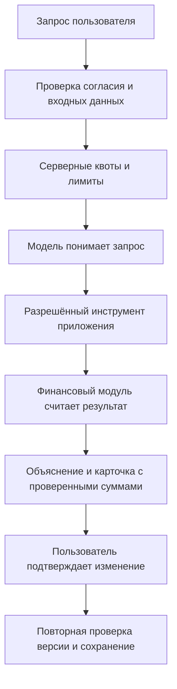
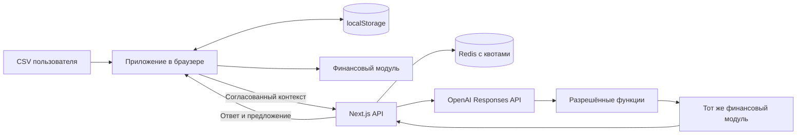

# Подробный план проекта финансового помощника с ИИ

Дата: 14 ноября 2026 года, версия 2. Трек: Money, Business Cup 2.0. Сдача: 15 ноября, 12:00 по времени мероприятия.

Продукт помогает работающим жителям США получить и поддерживать понятный план обязательных платежей. Пользователь загружает операции, подтверждает предложенные обязательства и получает ответ: какие платежи покрыты, сколько денег остаётся на выбранный период и как новая покупка изменит план. ИИ помогает разбирать данные, задаёт уточняющие вопросы и объясняет последствия решений.

Основная продуктовая ставка: сократить усилия на начало работы и регулярное поддержание бюджета для людей, которые уже перестали пользоваться сложными бюджетными приложениями.

Статусы утверждений: **[Ф]** — подтверждённое условие или возможность из указанного источника; **[Г]** — продуктовая или бизнес-гипотеза; **[Р]** — предлагаемое решение для реализации. Целевые показатели ниже являются требованиями к будущей проверке, а не достигнутыми результатами.

**Как читать план.** Разделы 1–14 описывают продукт и его устройство. Что именно делается до сдачи, задаёт раздел 15: объём хакатона, расписание по часам, контрольные точки и порядок сокращения. Решения, которые там не перечислены, относятся к развитию после хакатона, даже если описаны в других разделах.

## 1. Пользователь и проблема

**[Ф] Рамки кейса:** веб-продукт B2C для работающих взрослых 25–45 лет в США. Продукт должен решать проблему, за решение которой человек готов платить. Источник: [кейс Business Cup](https://www.canva.com/design/DAHa0haVbpw/6GF64XaZTkomHXIUkrxSjw/watch).

**[Г] Начальный сегмент:** человек получает регулярную зарплату, оплачивает несколько обязательных счетов и ранее пробовал приложение для бюджета, но перестал поддерживать его из-за количества ручных действий.

**[Г] Основная боль:** «На счёте есть деньги, но я не понимаю, сколько из них уже нужно на счета и что произойдёт, если сейчас сделать покупку».

**[Г] Дополнительные трудности:** настройка категорий занимает время; изменения в счетах легко пропустить; после перерыва трудно восстановить актуальный бюджет.

**[Г] Противоречие, которое нужно снять:** сегмент устал от ручной работы, а первая версия начинается с выгрузки CSV из банка. Ответ продукта: CSV — временный канал для проверки ценности; после импорта ручная работа сведена к подтверждениям, параметры плана предзаполняются по операциям (раздел 5), банковское подключение — первое расширение после пилота. Если на прохождениях выгрузка CSV окажется главным барьером, банковское подключение поднимается в приоритете.

Основание для выбора сегмента — исходное предложение для инвесторов (внутренний документ команды; в публичный репозиторий добавляется только после проверки содержимого). Упомянутый там набор отзывов даёт направление для исследования, но не устанавливает распространённость проблемы или готовность платить. Связанные исследовательские файлы не входят в текущий проект; использовать конкретные цитаты и статистику можно после проверки оригиналов.

## 2. Обещание продукта

**[Р] Формулировка:** «Получите проверяемый план счетов и свободного остатка с помощью короткого разговора и нескольких подтверждений».

**[Р] Пользователь получает:**

- Список обязательств с суммами, датами и статусом покрытия.
- Остаток после подтверждённых обязательств, базовых расходов и выбранного резерва.
- Объяснение каждой составляющей расчёта.
- Проверку последствий новой покупки до её совершения.
- Возможность обновить план фразой вроде «страховка подорожала на 30 долларов».

**[Г] Целевые показатели:** первый корректный план за 5 минут; последующая недельная проверка за 2 минуты. Время включает импорт, уточнения и исправление предложений ИИ.

## 3. Конкуренты и предполагаемое преимущество

| Альтернатива | Что уже существует [Ф] | Наш продуктовый акцент [Р] | Что требуется доказать [Г] |
| --- | --- | --- | --- |
| YNAB | Auto-Assign распределяет средства с использованием целей и запланированных операций | Начало работы через подтверждение обязательств и короткие вопросы | На одинаковой задаче меньше времени настройки и ошибок |
| PocketGuard | Leftover рассчитывает остаток с учётом расходов, целей и долгов | Проверяемый план на выбранный период с объяснением покрытия обязательств и последствий покупки | Пользователь быстрее понимает результат и его ограничения |
| Monarch | Есть AI-помощник, финансовые объяснения и недельный обзор | Разговор приводит к конкретному черновику изменения плана и карточке последствий | Пользователь выполняет задачу с меньшим количеством ручных действий |
| Таблица или заметки | Возможности зависят от используемого шаблона | Импорт, подсказки и пересчёт связаны в одном сценарии | Результат получается быстрее и требует меньше обслуживания |

Источники возможностей конкурентов: [YNAB Auto-Assign](https://support.ynab.com/en_us/auto-assign-a-guide-r1gBNbBJo), [PocketGuard Leftover](https://pocketguard.com/help/leftover/), [AI в Monarch](https://help.monarch.com/hc/en-us/articles/16116906962452-About-Monarch-s-AI-Features).

**[Г] Конкурентная ставка — совокупное удобство процесса:** импорт → уточнение → подтверждённый план → проверка покупки → короткое обновление. Наличие ИИ и отдельных функций само по себе не устанавливает преимущество. Подтверждённого барьера копирования сейчас нет.

**[Р] Отличие одной фразой для защиты:** «Мы не просто считаем остаток: каждая цифра раскрывается до операций-оснований, а покупку или изменение счёта можно проверить одной фразой и увидеть карточку „до и после“ ещё до сохранения». Это формулировка позиционирования; преимущество подтверждается только сравнительными задачами из раздела 17.

## 4. Состав первой версии

Все пункты этого раздела — **[Р]**. Приоритеты: **P0** — делается до сдачи 15 ноября и нужен для работающего основного сценария; **P1** — добавляется, только если P0 готов раньше контрольной точки 07:30 (раздел 15), иначе после хакатона; **P2** — развитие после хакатона.

| Возможность | Приоритет | Поведение | Критерий готовности |
| --- | --- | --- | --- |
| Гостевой вход | P0 | Пользователь открывает продукт без регистрации, выбирает пример или свои данные | Основной сценарий доступен жюри без входа |
| CSV и ручной ввод | P0 | Импорт операций, выбор колонок, ввод текущего баланса | Работает другой корректный CSV того же формата, ошибки видны пользователю |
| Помощь ИИ при настройке | P0 | Правила находят возможные регулярные платежи; ИИ объясняет кандидатов и уточняет неизвестное | Предложения опираются на импорт; пользователь может исправить или отклонить каждое |
| Предзаполнение параметров | P0 | Конец периода, базовые расходы и резерв предлагаются по операциям | Пользователь вводит только баланс; оценки помечены и требуют подтверждения |
| Подтверждение обязательств | P0 | Редактирование суммы, даты и статуса платежа | Без подтверждения обязательство не становится частью окончательного плана |
| План и список платежей | P0 | Показ обязательств, базовых расходов, резерва и свободного остатка | Изменение входных данных приводит к корректному пересчёту |
| Проверка покупки | P0 | Ввод суммы и даты через форму или разговор | Исходный план и результат симуляции показаны отдельно |
| Изменение платежа через ИИ | P0 | Фраза пользователя превращается в черновик изменения | Сохранение происходит только после подтверждения |
| Обновление плана | P0 | Предупреждение об устаревшем плане, ввод нового баланса, отметка оплаченных счетов, карточка «с прошлого обновления» | Видно, что изменилось и как изменился остаток; ничего не учитывается дважды |
| Локальное сохранение | P0 | Состояние сохраняется в `localStorage` с версией схемы | Перезагрузка сохраняет актуальный план |
| Мобильный интерфейс | P0 | Доступны все основные действия | Сценарий проходит при ширине 390 px |
| Календарь платежей | P1 | Календарное представление того же списка | Даты совпадают со списком и расчётом |
| Недельная проверка | P1 | Обзор новых и спорных изменений после повторного импорта | Видно, какие подтверждения изменят план |
| Экспорт и восстановление | P1 | Экспорт проекта в JSON и восстановление через проверенный импорт | Данные проходят ту же валидацию, что и обычный ввод |
| Возвращение после перерыва | P2 | Помощник выделяет накопившиеся существенные изменения | Сравнивается текущий импорт с последним подтверждённым состоянием |
| Аккаунты и синхронизация | P2 | План доступен на нескольких устройствах | Пользователь имеет доступ только к собственным данным |
| Банковское подключение | P2 | Получение операций через официальный API провайдера | Проверены согласие пользователя, повторы и актуальность данных |

**Почему «Обновление плана» в P0:** 20% оценки приходится на ценность и возвращаемость. Без этой функции демо показывает только первую настройку и не отвечает на вопрос, зачем пользователь вернётся. Облегчённая версия использует ручной ввод нового баланса и не требует повторного импорта.

Границы MVP: один денежный счёт, USD, английский интерфейс. Карточные минимальные платежи можно внести как обязательства; покупки в кредит, лимиты карт и расчёт процентов требуют отдельной модели. Реальные переводы, оплата счетов, инвестиционные операции и автоматическая отмена подписок в объём MVP не входят.

## 5. Основной пользовательский сценарий

Все решения этого раздела — **[Р]**.

1. Пользователь открывает сайт и выбирает `Try sample data` или `Import transactions`.
2. Приложение читает CSV в браузере, показывает колонки и ошибки. Пользователь подтверждает импорт.
3. Приложение предзаполняет параметры по операциям: конец периода — следующая ожидаемая дата зарплаты, если в CSV найден регулярный доход; базовые расходы — по тратам вне обязательных платежей за сопоставимый прошлый период; резерв — один из предложенных вариантов. Пользователь вводит текущий доступный баланс и подтверждает или исправляет остальное. До подтверждения оценки помечены, а план имеет статус «не подтверждён».
4. ИИ предлагает возможные регулярные платежи, указывает операции-основания и задаёт вопросы по неизвестным суммам или датам.
5. Пользователь подтверждает обязательства. Приложение рассчитывает план и открывает главный экран.
6. Пользователь спрашивает, как повлияет новая покупка. ИИ вызывает разрешённую функцию симуляции, затем объясняет полученный результат.
7. Пользователь может сохранить отдельный сценарий. Учёт фактически совершённой покупки требует отдельного действия; симуляция не меняет баланс.
8. Пользователь сообщает об изменении счёта, проверяет карточку до и после и подтверждает обновление.
9. Через несколько дней приложение показывает, что план устарел. Пользователь вводит новый баланс и отмечает оплаченные счета; карточка «с прошлого обновления» показывает, какие платежи закрыты, что осталось и как изменился свободный остаток.

### Числовой пример

Иллюстративные данные для демо, а не реальная финансовая рекомендация:

| Показатель | Сумма |
| --- | ---: |
| Текущий доступный баланс | $2 200 |
| Неоплаченные обязательства в выбранном периоде | $1 300 |
| Оставшиеся базовые расходы периода | $350 |
| Выбранный резерв | $250 |
| Остаток после всего перечисленного | **$300** |

Покупка на $400 создаёт нехватку $100 относительно выбранного плана. Обязательства и базовые расходы в этом примере ещё покрываются, но остаток резерва снизится до $150 при целевом значении $250. Интерфейс должен объяснить именно нарушение резерва; утверждение о нехватке денег на аренду здесь было бы ошибкой.

Если пользователь затем подтверждает повышение обязательного счёта на $30, свободный остаток исходного плана уменьшается с $300 до $270.

Через неделю пользователь вводит новый баланс $950 и отмечает аренду $1 100 оплаченной и уже учтённой в балансе. Необъяснённая разница $2 200 − $1 100 − $950 = $150 предлагается как траты из базовых расходов и после подтверждения уменьшает их остаток до $200. Новый расчёт: $950 − $230 − $200 − $250 = **$270**. Остаток не изменился, потому что траты шли по плану; карточка «с прошлого обновления» показывает закрытую аренду и уменьшение базовых расходов.

## 6. Экраны и состояния

Все решения этого раздела — **[Р]**.

| Экран | Содержание | Основные действия |
| --- | --- | --- |
| Старт `/` | Польза продукта, короткий пример, условия работы с данными | Открыть пример, начать со своими данными |
| Импорт `/setup/import` | Выбор файла, сопоставление колонок, предварительный просмотр | Исправить колонки, исключить спорную запись, подтвердить |
| Настройка `/setup/plan` | Баланс, период, расходы, резерв, предложения ИИ по обязательствам | Уточнить, редактировать, подтвердить план |
| Главная `/app` | Остаток, покрытие обязательств, резерв, ближайшие платежи, дата актуальности и предупреждение об устаревшем плане | Открыть расчёт, проверить покупку, обновить баланс, обратиться к помощнику |
| Платежи `/app/bills` | Список обязательств; календарь — P1 | Добавить, исправить, отметить оплату с указанием влияния на баланс |
| Настройки `/app/settings` | Параметры плана, AI-обработка, экспорт, удаление локальных данных | Изменить параметры, управлять своими данными |

Помощник на компьютере открывается в боковой панели, на телефоне — в отдельном полноэкранном представлении. Проверка покупки и подтверждение изменения используют общие карточки результатов.

Обязательные состояния: пустые данные; загрузка; неправильный CSV; частично разобранный импорт; неизвестная дата; недостаток денег; неподтверждённый план; устаревшие данные; недоступный ИИ; превышенная квота; ошибка сохранения. В каждом состоянии пользователь видит конкретное следующее действие.

До сдачи отдельный экран или сообщение обязательны для состояний: пустые данные, неправильный CSV, неизвестная дата, недостаток денег, неподтверждённый план, устаревшие данные, недоступный ИИ, превышенная квота. Остальные состояния до сдачи показываются общим понятным сообщением с действием «повторить» или «продолжить вручную».

Основной результат должен быть понятен без чтения переписки. В карточке остатка показываются период, дата актуальности, учтённые обязательства и доступ к формуле.

## 7. Финансовый модуль

Все правила этого раздела — **[Р]**. Это отдельный модуль TypeScript с одинаковой логикой в браузере и на сервере.

### Входные данные

- `balanceAsOf`: текущий доступный баланс и дата его актуальности.
- `horizonEndDate`: последняя дата планирования, например день следующей зарплаты.
- Подтверждённые неоплаченные обязательства с конкретными датами.
- Оставшиеся базовые расходы выбранного периода.
- Выбранный размер резерва.
- При симуляции — сумма покупки и дата.

### Расчёт

```text
planRemainder = currentAvailableCash
              - unpaidConfirmedBillsInHorizon
              - remainingEssentialExpenses
              - chosenReserve

purchaseScenarioRemainder = planRemainder - purchaseAmount
```

Период включает текущую дату и конечную дату. Обязательства в день следующей зарплаты учитываются; ожидаемая зарплата не прибавляется к уже полученным деньгам. Пользователь видит обязательства за пределами периода отдельно. Остаток относится только к указанному периоду и учтённым данным.

Статус результата определяется последовательно: если денег не хватает на все счета, показывается общая нехватка на обязательства; если счета покрыты, но не покрыты базовые расходы, показывается эта нехватка; если оба блока покрыты, но нарушен целевой резерв, показывается нехватка резерва. При общем дефиците конкретные платежи нельзя отмечать обеспеченными без согласованного пользователем порядка распределения.

### Правила корректности

1. Деньги хранятся целым числом центов. Валюта MVP — USD.
2. CSV прошлых операций используется для поиска закономерностей; его расходы не вычитаются повторно из введённого текущего баланса.
3. Платежи со статусом «уже оплачен» не входят в будущие списания. При отметке оплаты пользователь указывает, учтено ли списание в текущем балансе.
4. Покупка в режиме проверки не создаёт фактическую операцию. При подтверждении фактической траты баланс изменяется один раз.
5. Ожидаемые возвраты и доходы не включаются в доступные деньги до подтверждения получения.
6. Pending-операции, внутренние переводы и спорные дубликаты требуют явного решения. Правило учёта не должно дважды уменьшать уже уменьшенный банковский доступный баланс.
7. Отрицательный остаток сохраняется и показывается как нехватка; его нельзя заменять нулём.
8. Резерв отражает отдельное пожелание пользователя. Нарушение резерва отличается от нехватки на обязательный платёж.
9. При дефиците интерфейс показывает платежи и суммы. Предложенный порядок покрытия требует подтверждения; программа не принимает решение о переносе счетов за пользователя.
10. Изменение дат или границ периода требует повторного подтверждения базовых расходов периода, если их размер больше не соответствует выбранным датам.
11. Каждое изменение увеличивает `stateVersion`. Перед применением предложения проверяются версия и актуальный расчёт.
12. Финансовые даты хранятся как календарные `YYYY-MM-DD`; технические события — в UTC. Отображение дат адаптируется для en-US без сдвига даты из-за часового пояса.
13. Симуляция относится к покупке внутри текущего периода. Для другой даты предлагается пересмотреть период и исходные расходы, а не молча применить прежний расчёт.
14. Фактическая трата связывается с назначением денег. Если это уже предусмотренный счёт, закрывается соответствующее обязательство; если базовые расходы — уменьшается их оставшийся бюджет. Списание и изменение будущего покрытия выполняются одной операцией, чтобы не учесть расход дважды.
15. Обновление баланса создаёт новый снимок `balanceAsOf`. Платежи, отмеченные оплаченными и учтёнными в новом снимке, выходят из будущих списаний. Необъяснённое уменьшение баланса предлагается как траты из базовых расходов и требует подтверждения; если разница больше оставшихся базовых расходов, превышение показывается отдельно и не распределяется молча. Необъяснённое увеличение вызывает вопрос о поступлении; если пришла зарплата, предлагается начать новый период.

## 8. Роль ИИ и подтверждение изменений

Все продуктовые решения этого раздела — **[Р]**.

ИИ помогает преобразовать разговор и неоднозначные описания в проверяемые предложения. Финансовый модуль вычисляет суммы; интерфейс отображает их из структурированного результата.

### Задачи ИИ

| Задача | Вход | Результат |
| --- | --- | --- |
| Предложить регулярные платежи | Ограниченный набор операций с датами, суммами и очищенными описаниями | Кандидаты с операциями-основаниями и вопросами для подтверждения |
| Уточнить настройку | Неполные поля плана | Один понятный вопрос о недостающем существенном поле |
| Проверить покупку | Фраза пользователя, актуальное состояние | Вызов симуляции и объяснение её результата |
| Изменить обязательство | Фраза и существующие платежи | Черновик изменения конкретного платежа |
| Объяснить план | Расчёт, обязательства и ссылки на факты | Краткое объяснение с возможностью открыть основания |
| Сделать недельный обзор | Подтверждённые изменения после повторного импорта | Перечень существенных изменений и необходимых подтверждений, P1 |

Если в сообщении есть два подходящих платежа или неизвестна дата, помощник задаёт вопрос. Отсутствующее значение не заменяется выдуманным.

### Разрешённые инструменты помощника

| Инструмент | Назначение | Запись в данные |
| --- | --- | --- |
| `get_plan_summary()` | Получить расчёт и ссылки на исходные обязательства | Нет |
| `simulate_purchase(amountCents, purchaseDate)` | Рассчитать последствия гипотетической покупки | Нет |
| `propose_bill_change(billId, changes)` | Подготовить изменение с результатом до и после | Создаётся только черновик ответа |
| `propose_new_bill(candidate)` | Подготовить новый платёж с основаниями | Создаётся только черновик ответа |

Сохранение выполняет функция приложения `applyConfirmedProposal()`, доступная кнопке подтверждения. Модель не получает инструмент прямого сохранения. На подтверждении повторяются проверка полей, версии и финансовый расчёт. Повторное нажатие не создаёт второе изменение.

### Поток AI-запроса



Для связки модели с функциями приложения используем [function calling](https://developers.openai.com/api/docs/guides/function-calling). Для предложений и ответа используем [Structured Outputs](https://developers.openai.com/api/docs/guides/structured-outputs?api-mode=responses) и проверку Zod. **[Ф]** Заданная структура ограничивает формат ответа; финансовые правила всё равно проверяет приложение.

### Требования к ответу

- Ответ содержит тип действия, объяснение, ссылки на факты и при необходимости черновик изменения.
- Суммы и даты в карточках берутся из результатов инструментов. Денежные выводы MVP формируются из проверенных полей и шаблонов.
- У обязательства виден источник: операция, ручной ввод или подтверждение пользователя.
- Тексты CSV и описания операций считаются данными и не могут разрешать модели новые действия.
- Модель работает с фиксированным списком инструментов. Чужие ссылки, произвольный код и запросы SQL через помощника не исполняются.
- На ошибку API, отказ или неполный ответ предусмотрено понятное состояние; ручной план и формы остаются доступны.

## 9. Технологии и причины выбора

Выбор технологий — **[Р]**. Версии фиксируются в lockfile при начале разработки; обновления во время подготовки демо допускаются при конкретной необходимости.

| Область | Технология | Назначение и причина выбора | Этап |
| --- | --- | --- | --- |
| Приложение | Next.js App Router + React + TypeScript | Интерфейс и серверные API в одном проекте; общий язык для финансового модуля | MVP |
| Стили и компоненты | Tailwind CSS + shadcn/ui | Формы, таблицы, диалоги и мобильная компоновка | MVP |
| Иконки | Lucide React | Единый набор понятных иконок | MVP |
| CSV | Papa Parse | Чтение локальных файлов и обработка ошибок формата | MVP |
| Схемы данных | Zod | Общая проверка ручного ввода, импорта, API и предложений ИИ | MVP |
| Локальные данные | `localStorage`, один документ с `schemaVersion` и проверкой Zod при чтении | Операции и план сохраняются в браузере; объёма до 5 000 операций достаточно | MVP хакатона; IndexedDB и `idb` — при росте данных |
| AI-интеграция | Официальный OpenAI SDK, Responses API | Запросы к модели, function calling, структурированные ответы | MVP |
| Начальная модель | `gpt-6.1-sol`, параметр `OPENAI_MODEL` | Кандидат для разбора запросов и работы с инструментами; доступ и качество проверяются первым действием | MVP; запасная модель с проверенным доступом назначается вручную |
| Лимиты запросов | Upstash Redis + `@upstash/ratelimit` | Глобальный дневной бюджет и мягкий лимит на клиента, общие между экземплярами приложения | До публичной ссылки с включённым ИИ |
| Проверка логики | Vitest | Контроль финансовых правил, импорта и применения предложений | MVP |
| Проверка сценария | Playwright | Проверка в браузере на компьютере и телефоне | После хакатона; до сдачи — ручной чек-лист раздела 16 |
| Публикация | Vercel | Размещение Next.js и серверного AI-обработчика | MVP |
| Облачные данные | Supabase PostgreSQL + Auth + RLS | Аккаунты, синхронизация и разграничение доступа | Пилот после MVP |

**[Ф]** `gpt-6.1-sol` поддерживает вызов инструментов через Responses API; модель описана в [официальной документации OpenAI](https://developers.openai.com/api/docs/models/gpt-6.1-sol). **[Р]** Начальная настройка — `reasoning.effort: low`; модель оценивается на подготовленных сценариях, а доступность не предполагается автоматически для любого аккаунта. Автоматической подмены на другую модель нет.

**[Р]** Доступ к модели и работа инструментов проверяются тестовым вызовом до начала ИИ-части. Если модель недоступна, нестабильна на подготовленных сценариях или слишком медленна для демо, `OPENAI_MODEL` вручную переключается на запасную модель с проверенным доступом, и оценочные сценарии повторяются на ней до записи видео.

Финансовые расчёты выполняет собственный модуль. Распознавание повторов сначала сокращает данные обычными правилами, затем ИИ помогает интерпретировать кандидатов. На старте достаточно прямого SDK и фиксированного списка инструментов.

## 10. Архитектура и поток данных

Все решения этого раздела — **[Р]**.



### Где находятся данные

- Исходный CSV, операции, обязательства и подтверждённый план хранятся в браузере.
- Сервер получает только контекст, нужный для конкретной AI-задачи, после согласия пользователя.
- Финансовый модуль импортируется из одного общего модуля. Сервер повторяет расчёт перед формированием ответа помощника.
- Сервер приложения не сохраняет выписки и переписку в БД или прикладных логах MVP.
- Redis хранит счётчики квот и технические идентификаторы с ограниченным временем жизни.
- Провайдер модели обрабатывает переданные данные. Условия обработки и хранения у провайдера описываются отдельно; локальное хранение приложения не означает локальную работу модели.

### Обработка CSV

1. Проверить размер, доступность файла и число строк.
2. Прочитать CSV через Papa Parse; показать выбранные колонки и ошибки.
3. Преобразовать даты и суммы в единую внутреннюю схему.
4. Проверить обязательные поля и неоднозначные значения.
5. Определить возможные дубликаты и переводы; показать спорные случаи.
6. Сохранить подтверждённый импорт и его идентификатор.
7. Сгруппировать возможные повторы в браузере.
8. При включённом ИИ отправить ограниченный набор кандидатов для объяснения и уточнения.

Начальные технические ограничения: файл до 2 MB, до 5 000 операций, только USD. Это параметры MVP, которые уточняются после проверки на разных файлах. CSV должен иметь дату, описание и сумму; два столбца debit/credit преобразуются только после явного сопоставления. Неоднозначные форматы дат требуют выбора пользователя.

### Облачное развитие

Для пилота добавляются Supabase Auth и PostgreSQL. Каждая пользовательская запись получает `user_id`; политики RLS ограничивают чтение, создание, изменение и удаление владельцем. Перенос локального плана в облако выполняется отдельным действием пользователя. Облачное сохранение не является условием прохождения гостевого демо.

## 11. Модель данных

Все сущности — **[Р]**. До сдачи они хранятся в `localStorage` одним версионированным документом; IndexedDB подключается при росте объёма данных. Для облачной версии проектируются таблицы с соответствующими связями и индексами.

| Сущность | Основные поля | Назначение |
| --- | --- | --- |
| `Account` | `id`, `currency`, `availableBalanceCents`, `balanceAsOf` | Снимок доступного баланса одного денежного счёта |
| `BalanceSnapshot` | `id`, `accountId`, `balanceCents`, `asOf`, `stateVersion` | Прошлые снимки баланса для карточки «с прошлого обновления» |
| `ImportBatch` | `id`, `fileHash`, `columnMapping`, `importedAt` | Источник операций и контроль повторного импорта |
| `Transaction` | `id`, `accountId`, `importBatchId`, `sourceId`, `postedDate`, `description`, `amountCents`, `kind`, `reviewStatus` | Исторические данные для анализа и подтверждения |
| `Obligation` | `id`, `accountId`, `name`, `amountCents`, `dueDate`, `paymentStatus`, `confirmationStatus`, `sourceTransactionIds` | Конкретный обязательный платёж |
| `Plan` | `id`, `accountId`, `startDate`, `endDate`, `essentialRemainingCents`, `reserveTargetCents`, `stateVersion` | Параметры текущего расчёта |
| `Scenario` | `id`, `planId`, `baseVersion`, `purchaseDate`, `amountCents` | Гипотетическая покупка, не фактическое списание |
| `ChangeProposal` | `id`, `baseVersion`, `type`, `targetId`, `changes`, `factRefs`, `status` | Проверяемое предложение до подтверждения |
| `ChangeEvent` | `id`, `proposalId`, `entityId`, `before`, `after`, `createdAt` | Защита от повторного применения; до сдачи достаточно списка применённых `proposalId`, полная история — после хакатона |
| `ConsentSettings` | `aiEnabled`, `scopes`, `acceptedAt`, `policyVersion` | Выбранные пользователем параметры AI-обработки; до сдачи — `aiEnabled` и `acceptedAt` |

Дополнительные правила:

- `Obligation` представляет конкретное наступление платежа. Шаблон повторения и отдельный платёж разделяются при добавлении регулярного планирования.
- Валюта и сумма проверяются в каждой денежной сущности. Денежные значения — целые центы с ограничением допустимого диапазона.
- Совпадение даты, суммы и описания является признаком возможного дубликата, но не основанием молча удалить одну из двух операций.
- `schemaVersion` описывает формат хранилища; `stateVersion` — текущую версию пользовательского плана.
- Вычисляемые итоги пересчитываются из исходных данных. Сохранённая карточка сценария не становится самостоятельным источником баланса.

## 12. API и контракты

Все контракты — **[Р]**.

| Метод и путь | Вход | Выход | Проверки |
| --- | --- | --- | --- |
| `POST /api/guest-session` | Запрос с сайта | Подписанная гостевая cookie | Origin, срок жизни, допустимая частота; после хакатона |
| `POST /api/assistant` | Режим задачи, сообщение, минимальный контекст, версия плана, отметка согласия | Объяснение, ссылки на факты, результат симуляции или черновик изменения | Схема, объём, согласие, Origin, квота, инструменты и актуальность контекста |
| `GET /api/health` | Нет | Общий статус приложения | Ответ не содержит ключи и содержимое env |

Режимы `/api/assistant`: `setup`, `explain`, `simulate`, `propose_change`. Финансовые инструменты являются внутренними функциями сервера; клиент не может передать произвольное имя функции или адрес назначения.

До сдачи `/api/guest-session` не реализуется. Публичный AI-endpoint защищают проверка Origin, мягкий лимит на клиента и глобальный дневной бюджет (раздел 13). Подписанная гостевая сессия добавляется перед пилотом.

Схематический ответ:

```json
{
  "kind": "change_proposal",
  "baseVersion": 7,
  "message": "Проверьте изменение страхового платежа.",
  "factRefs": ["bill_insurance", "plan_remainder"],
  "proposal": {
    "id": "proposal_example",
    "type": "update_obligation",
    "targetId": "bill_insurance",
    "changes": { "amountCents": 18000 }
  },
  "requiresConfirmation": true
}
```

Это пример контракта, не готовая схема OpenAI. Фактические допустимые типы изменений, обязательные поля и диапазоны фиксируются Zod/JSON Schema при реализации. Приложение проверяет, что `targetId` и все `factRefs` существуют в текущем контексте.

В MVP подтверждение сохраняет изменения локально через общий модуль, а затем обновляет версию. В облачной версии появляется серверный маршрут применения изменений с проверкой владельца, версии и идентификатора повторного запроса.

## 13. Приватность и контроль расходов на ИИ

Все требования — **[Р]**.

### Данные пользователя

- До первого AI-запроса пользователь видит, какие категории данных отправляются и как отключить обработку.
- CSV разбирается локально. Файл целиком не отправляется модели по умолчанию.
- Для объяснения плана достаточно сумм, дат, типов и внутренних идентификаторов. Для распознавания нужны ограниченные очищенные описания; перед отправкой показывается состав данных.
- Удаляются номера счетов, контактные данные и очевидные личные идентификаторы. Система не обещает полную анонимность финансовых данных.
- Сырые сообщения, описания операций, балансы и тело CSV не попадают в аналитику и прикладные логи.
- Метрики содержат длительность задачи, технический статус и число исправлений без содержания операций.
- Пользователь может очистить локальные финансовые данные через настройки. Удаление в приложении и политика хранения провайдера описываются раздельно.
- Локальное сохранение действует в текущем браузере. До появления аккаунтов восстановление на другом устройстве требует отдельного экспорта и импорта.

### Сервер и квоты

- `OPENAI_API_KEY` и ключи Redis доступны только серверу, не имеют префикса `NEXT_PUBLIC_` и не включаются в репозиторий.
- Origin проверяется на сервере. Ни Origin, ни скрытый ключ не защищают публичный AI-endpoint от расходования квоты: основную защиту даёт глобальный бюджет. Подписанная гостевая cookie добавляется перед пилотом.
- Ограничения считаются в общем Redis, а не только в памяти одного серверного процесса.
- Начальные настройки: глобальный дневной бюджет `AI_DAILY_BUDGET_USD`; мягкий лимит на клиента (идентификатор браузера и IP) — порядка 30 запросов в минуту, потому что жюри и другие команды могут находиться в одной сети площадки. Значения проверяются на сценарии демо до записи видео.
- Запрос содержит ограниченную историю и только относящийся к задаче контекст. Первичная группировка CSV сокращает объём до отправки.
- До 3 вызовов инструментов в одном пользовательском запросе; установлен предел выходных токенов и общий таймаут.
- Глобальная квота учитывает максимально возможный расход перед вызовом и уточняется по фактическому usage. При исчерпании квоты ИИ показывает понятное состояние.
- Если сервис квот недоступен, платный AI-вызов не запускается. Ручные функции приложения продолжают работать.
- Вторая линия защиты — лимит расходов проекта в кабинете провайдера, если аккаунт поддерживает жёсткое ограничение. Переменная `AI_ENABLED=false` выключает ИИ повторным деплоем без изменения кода; ручной сценарий при этом работает.
- Стоимость рассчитывается по токенам и актуальной цене выбранной модели. Выручка и себестоимость не выводятся из одного заранее выбранного удачного запроса.

## 14. Структура проекта и конфигурация

Все решения — **[Р]**.

```text
PROJECT_PLAN.md
app/
  src/
    app/
      page.tsx
      setup/
      app/
      api/assistant/route.ts
      api/health/route.ts
    components/
      onboarding/
      plan/
      bills/
      assistant/
      scenarios/
      ui/
    lib/
      finance/          общий модуль расчётов и применения изменений
      import/           чтение CSV и нормализация
      schemas/          схемы данных и API
      storage/          IndexedDB и миграции
      ai/               серверный клиент, инструкции, инструменты и контекст
      limits/           серверные квоты
    demo/               синтетические данные и ожидаемые результаты
  tests/
    unit/
    e2e/                после хакатона
  .env.example
  README.md
```

Основная конфигурация: `OPENAI_API_KEY`, `OPENAI_MODEL`, `AI_ENABLED`, `AI_DAILY_BUDGET_USD`, `UPSTASH_REDIS_REST_URL`, `UPSTASH_REDIS_REST_TOKEN`. После хакатона добавляется `SESSION_SIGNING_SECRET` для подписанной гостевой сессии. Пример env содержит только названия и безопасные примеры значений.

Конфигурация облачного пилота добавляется при реализации Supabase. Серверный ключ с расширенными правами не передаётся клиенту; пользовательские операции ограничиваются политиками доступа.

## 15. План до сдачи

Все решения этого раздела — **[Р]**. Время местное (Алматы, UTC+5); если дедлайн мероприятия задан в другом часовом поясе, расписание сдвигается целиком. Ориентир — работающий продукт с ИИ на публичной ссылке; остальное подчинено ему.

### Объём до сдачи

| Делаем | Откладываем на после хакатона |
| --- | --- |
| Финансовый модуль и Vitest по таблице раздела 16 | Подписанную гостевую сессию и `/api/guest-session` |
| Импорт CSV, правила поиска повторов, предзаполнение параметров | IndexedDB и миграции схемы |
| Подтверждение обязательств, главная, список платежей | Календарный вид, экспорт и восстановление JSON |
| Проверка покупки формой и через ИИ | Полную историю `ChangeEvent` |
| Изменение счёта через ИИ с подтверждением | Playwright и набор из 20+ AI-кейсов |
| Обновление плана: новый баланс, оплаченные счета, карточка изменений | Недельную проверку с повторным импортом |
| `localStorage`, мобильная вёрстка 390 px | Интервью 10–15 человек и сравнение с альтернативами |
| Глобальный AI-бюджет в Upstash и лимит провайдера | Supabase, аккаунты, банковское подключение |

### Расписание

| Время | Работа | Контрольная точка |
| --- | --- | --- |
| 18:30–19:15 | Zod-схемы, формат CSV, два синтетических CSV с ожидаемыми числами; тестовый вызов модели с инструментом; пустой проект Next.js опубликован на Vercel с переменными окружения; часовой пояс дедлайна сверен | Публичная ссылка открывается, модель отвечает |
| 19:15–21:30 | Финансовый модуль: план, дефицит и его порядок, резерв, симуляция, применение предложения, обновление баланса | Все финансовые случаи раздела 16 проходят в Vitest |
| 21:30–01:00 | Импорт с сопоставлением колонок, поиск повторов правилами, предзаполнение, подтверждение обязательств, главная, проверка покупки формой, обновление плана, `localStorage` | **01:00:** весь сценарий проходит вручную без ИИ на публичной ссылке |
| 01:00–04:30 | `/api/assistant`, контекст, три инструмента, карточки предложений, `applyConfirmedProposal()`, бюджет в Upstash | **04:30:** три AI-сценария работают на публичной ссылке |
| 04:30–07:30 | Сон или резерв на отставание | — |
| 07:30–09:30 | Ширина 390 px, обязательные состояния, отказ ИИ, повторное и устаревшее подтверждение, 8 AI-кейсов | **09:30:** чек-лист раздела 16 пройден, новые функции больше не добавляются |
| 09:30–10:30 | 3–5 наблюдаемых прохождений, исправление 2–3 главных проблем, запись запасного видео | Видео записано, замечания зафиксированы |
| 10:30–11:30 | README, PDF до 10 слайдов, финальный деплой, проверка ссылки, репозитория и PDF с другого устройства | Комплект сдачи готов |
| 11:30–11:45 | Отправка материалов | Отправлено не позже 11:45 |

Публикация на Vercel начинается в первый час, а не в конце: ошибки окружения обнаруживаются, пока есть время. Каждая контрольная точка проверяется на публичной ссылке, а не только локально.

Если в команде 2–3 человека, после 19:15 работа идёт параллельно на общих контрактах: первый — финансовый модуль, затем сервер ИИ; второй — экраны на тестовых данных по контракту модуля; третий — импорт CSV и демо-данные, с 07:30 — README, слайды и прохождения.

### Порядок сокращения

Если контрольная точка пропущена больше чем на час, функции упрощаются в этом порядке:

1. Предзаполнение базовых расходов → пользователь вводит их сам с подсказкой.
2. Карточка «с прошлого обновления» → остаются предупреждение об устаревшем плане и ввод нового баланса.
3. ИИ при настройке → правила находят кандидатов, пользователь подтверждает их без объяснений модели.
4. Изменение счёта через ИИ → форма с той же карточкой «до и после».

Не сокращаются: финансовый модуль с тестами, ручной сценарий на собственном CSV, минимум один AI-сценарий через реальный API (проверка покупки), публичная ссылка и запасное видео.

### Рабочие блоки

- Продукт: пользователь, боль, гипотеза цены, сценарий, подтверждение объёма.
- Данные и расчёты: импорт, сущности, финансовый модуль, проверки корректности.
- Интерфейс: настройка, план, обязательства, симуляция, обновление плана и мобильная версия.
- ИИ: контекст, разрешённые инструменты, ответы, уточнения и подтверждения.
- Выпуск: сборка, проверки в браузере, демо-данные, README и материалы защиты.

Блоки имеют общие контракты данных. Изменение формата денег, статусов или версии плана согласуется до интеграции экранов и ИИ.

### После хакатона

| Этап | Работа | Проверяемый результат |
| --- | --- | --- |
| 1. Укрепить основу | Подписанная гостевая сессия, IndexedDB, Playwright, полный набор AI-кейсов | Сценарий проверяется автоматически на компьютере и телефоне |
| 2. Проверить пользу | 10–15 интервью в сегменте США, сравнение с альтернативами на одинаковой задаче | Есть измерения времени, ошибок и предпочтений |
| 3. Удержание | Недельная проверка с повторным импортом, календарь, экспорт | Поддержание плана занимает до 2 минут в неделю |
| 4. Пилот | Supabase, аккаунты, синхронизация, предложение подписки | Четырёхнедельный пилот с D7/D30 и фактической оплатой |
| 5. Банковское подключение | Официальный API провайдера вместо CSV | Снят главный ручной шаг начала работы |

## 16. Проверка качества

Все требования — **[Р]**. Проверки подтверждают поведение продукта; опубликованные результаты относятся только к реально выполненным проверкам. До сдачи финансовые случаи проверяются в Vitest, AI-сценарии и браузер — вручную по спискам ниже.

### Финансовые случаи

| Случай | Ожидаемый результат |
| --- | --- |
| Баланс 220000, счета 130000, базовые расходы 35000, резерв 25000 центов | Остаток 30000 центов |
| К предыдущему плану добавлена симуляция покупки 40000 центов | Остаток сценария −10000; дефицит относится к выбранному резерву |
| Подтверждённый счёт увеличен на 3000 центов | Исходный остаток становится 27000 центов |
| Импортирована прошлая трата, уже отражённая в балансе | Текущий баланс повторно не уменьшается |
| Из базового бюджета потрачено 2000 центов, списание ещё не отражено в снимке баланса | Баланс и оставшиеся базовые расходы уменьшаются на 2000; свободный остаток не меняется |
| Дата симуляции находится за пределами плана | Предлагается пересмотр периода, текущий план не изменяется |
| Добавлена ожидаемая зарплата | Доступный остаток не увеличивается до фактического получения |
| Два одинаковых легитимных списания | Система предлагает проверку и не удаляет запись молча |
| Остаток отрицательный | Видна точная нехватка и её составляющие |
| Платёж приходится на последний день периода | Платёж включён в расчёт |
| Предложение создано до изменения плана | На подтверждении выполняется новый расчёт либо предложение отклоняется как устаревшее |
| Пользователь дважды подтверждает предложение | Изменение применяется один раз |
| После повышения счёта: новый баланс 95000, аренда 110000 оплачена и учтена в снимке, разница 15000 подтверждена как базовые расходы | Обязательства 23000, базовые расходы 20000, остаток 27000 без изменения |
| Необъяснённое уменьшение баланса больше оставшихся базовых расходов | Превышение показано отдельно и не распределяется молча |
| Параметры предзаполнены, но не подтверждены | План имеет статус «не подтверждён»; итог не выдаётся за окончательный |

### AI-сценарии

До сдачи — 8 ручных примеров: две перефразировки покупки, изменение суммы счёта, неизвестная дата, два похожих платежа, запрос без данных, недоступный API и инструкция, спрятанная в описании операции. После хакатона набор расширяется до 20+ примеров, включая ошибочное имя и неполный импорт.

Критерии допуска: отсутствие неподтверждённых изменений; денежные карточки совпадают с финансовым модулем; неизвестные существенные поля уточняются; отклонение или ошибка модели не разрушает план. Качество распознавания оценивается отдельно от правильности арифметики.

### Проверка в браузере

До сдачи список проходится вручную; Playwright — после хакатона.

- Новый пользователь проходит от стартового экрана до плана и проверки покупки.
- Проходит сценарий со вторым CSV и другими суммами.
- Изменение счёта через разговор требует подтверждения и обновляет результат.
- Перезагрузка сохраняет состояние; повторное подтверждение не дублирует изменение.
- Обновление баланса показывает карточку «с прошлого обновления»; оплаченный счёт не вычитается повторно.
- Ширина 390 px позволяет пройти тот же сценарий.
- При отключённом ИИ и при исчерпанной квоте доступны ручные формы.
- Сборка, проверка TypeScript, линтер и необходимые автоматические проверки проходят.

## 17. Проверка спроса и метрики

Все показатели — **[Г]** до получения результатов.

| Вопрос | Как проверяем | Что считаем результатом |
| --- | --- | --- |
| Есть ли выбранная боль | 10–15 интервью с представителями сегмента в США | Конкретные недавние случаи, последствия и текущие альтернативы |
| Быстрее ли первый результат | Одинаковые данные и задача в нашем продукте и выбранных альтернативах | Время, завершение задачи, ошибки и помощь наблюдателя |
| Помогает ли ИИ | Сопоставимые задачи с помощником и ручной формой | Число действий, время, исправления и понимание результата |
| Понятны ли последствия покупки | Пользователь объясняет результат своими словами | Верное различение свободных денег, резерва и обязательств |
| Возвращается ли пользователь | Четырёхнедельный пилот | Поддержание актуального плана, D7/D30 и время обслуживания |
| Готов ли платить | Предложение доступной подписки на реально работающий продукт | Фактическая оплата и последующее использование |

На хакатоне минимум 3–5 наблюдаемых прохождений дают раннюю проверку удобства. Если участники не относятся к выбранному сегменту США, эти прохождения не считаются подтверждением спроса сегмента. Интервью, сравнение с альтернативами и пилот проводятся после сдачи; в презентации они показываются как план проверки, а не как результат.

Метрики продукта: время до первого корректного плана, доля завершивших настройку, число исправленных AI-предложений, время недельной проверки, использование симуляции, стоимость AI-задачи. Предотвращённые комиссии считаются только по подтверждённым событиям, отдельно от прогнозов.

## 18. Монетизация и бизнес

**[Г] Модель:** подписка за постоянное поддержание плана и помощь ИИ. Начальная гипотеза цены — $10 в месяц. Пробный доступ должен позволять получить и проверить основной результат; гостевое демо для жюри сохраняется.

Пользователь платит за сокращение ручной работы, понимание обязательств и помощь при изменениях. Готовность платить за эти результаты проверяется отдельно от интереса к ИИ.

Арифметические сценарии при гипотетической цене $10 в месяц, без учёта скидок, оттока и комиссий:

| Платящих пользователей | Годовая повторяющаяся выручка |
| ---: | ---: |
| 10 000 | $1,2 млн |
| 100 000 | $12 млн |
| 834 000 | $100,08 млн |

Это расчёт масштаба, а не прогноз спроса. Потенциал рынка и достижимость такого числа подписчиков требуют исследования.

Упрощённая юнит-экономика: месячная выручка минус AI, инфраструктура, платёжные комиссии и переменные затраты поддержки. Валовый LTV оценивается через ARPU, валовую маржу и срок жизни подписчика; CAC — через измеряемые затраты привлечения. До пилота эти параметры не выдаются за установленные значения.

**[Г] Первые каналы:** сообщества людей, которые пробовали бюджетные приложения; рекомендации участников пилота; полезные материалы о планировании платежей. Эффективность и стоимость каждого канала проверяются небольшими экспериментами. Партнёрства и собственная аудитория сейчас не заявляются.

## 19. Риски и продуктовые решения

Все риски — вопросы к проверке, решения — **[Р]**.

| Риск | Решение | Проверка |
| --- | --- | --- |
| Пользователь получает неверную уверенность из неполных данных | Видимые период, актуальность, допущения и неподтверждённые поля | Пользователь правильно объясняет границы результата |
| ИИ ошибается в счёте или дате | Ссылки на источники, вопросы и подтверждение | Тесты неоднозначных операций |
| Расчёт дважды учитывает расход | Разделение истории, снимка баланса и будущих обязательств | Числовые проверки и повторный импорт |
| AI-доступ расходует слишком много средств | Серверные квоты, ограниченный контекст и общий бюджет | Проверка повторных и параллельных запросов |
| Пользователь не хочет отправлять финансовые данные | Управление AI-обработкой и ручной сценарий | Проверка понятности выбора и состава отправки |
| Продукт недостаточно отличается от аналогов | Сравнительные задачи и узкий сегмент | Время, ошибки, предпочтение и оплата |
| Начало через CSV противоречит обещанию меньшей ручной работы | Импорт сведён к подтверждениям, параметры предзаполняются, банковское подключение — первое расширение | Время и затруднения на шаге выгрузки CSV в прохождениях |
| Проект не укладывается в объём хакатона | Объём, расписание, контрольные точки и порядок сокращения раздела 15; публикация с первого часа | Полный сценарий проходит на публичной ссылке к 09:30 |

## 20. Что показываем жюри

**[Р] Демо на 100–120 секунд:** открыть синтетический пример → подтвердить предложенные ИИ обязательства → увидеть реальный расчёт → спросить о покупке → открыть последствия → изменить счёт через разговор → подтвердить и увидеть обновление → обновить план: ввести новый баланс, отметить аренду оплаченной и увидеть карточку изменений.

Демо должно позволять менять значения. Объяснения ИИ генерируются через реальный API, суммы рассчитываются модулем. Подготовленный CSV обозначается как пример. Запасное видео используется при техническом сбое и называется записью.

**[Р] Структура защиты на 5 минут:** 0:00–0:40 — пользователь и ситуация; 0:40–1:00 — альтернативы и отличие одной фразой; 1:00–3:00 — живое демо; 3:00–3:40 — что проверено и что нет; 3:40–4:30 — бизнес-модель и ближайший пилот; 4:30–5:00 — ограничения и следующий шаг. Ответы заранее готовятся на ожидаемые вопросы: почему CSV, чем продукт отличается от PocketGuard и Monarch, какие финансовые данные видит модель, сколько стоит одна AI-задача по фактическому usage.

**[Ф] Приоритеты оценки из кейса:** работающий продукт и инженерная реализация — 40%; ценность и возвращаемость — 20%; проблема и пользователь — 15%; бизнес-потенциал — 15%; оригинальность — 10%.

**[Ф] Комплект сдачи:** PDF до 10 слайдов, публичная рабочая ссылка без обязательного входа, публичный GitHub-репозиторий. Дедлайн — 15 ноября, 12:00 по времени мероприятия. Защита — 5 минут и 2 минуты вопросов. Источник: [кейс](https://www.canva.com/design/DAHa0haVbpw/6GF64XaZTkomHXIUkrxSjw/watch).

**[Р]** Часовой пояс дедлайна сверяется с организаторами в первый час работы; расписание раздела 15 составлено по Алматы.

**[Р] Содержание презентации:** пользователь и ситуация; гипотеза проблемы и что уже наблюдали; текущие альтернативы; решение; живое демо; результаты проверок; отличие; бизнес-модель; ограничения; ближайший пилот. Все числа отмечаются источником, результатом проверки или статусом оценки.

## 21. Критерии готовности проекта

### К сдаче 15 ноября

- [ ] Пользователь из США понимает назначение продукта по первому экрану.
- [ ] CSV с другими корректными данными проходит импорт и даёт новый результат.
- [ ] Все обязательства в окончательном плане подтверждены пользователем.
- [ ] Суммы и последствия покупок проверены на независимых примерах.
- [ ] ИИ помогает настроить план, проверить покупку и подготовить изменение платежа.
- [ ] ИИ не сохраняет изменения без пользовательского подтверждения.
- [ ] Устаревшее или повторно отправленное предложение не портит данные.
- [ ] Данные сохраняются после перезагрузки, а симуляция не меняет фактический баланс.
- [ ] Обновление баланса показывает изменения с прошлого раза и ничего не учитывает дважды.
- [ ] Мобильный и настольный сценарии проходят в браузере.
- [ ] Ошибки импорта, ИИ и квот имеют понятные состояния.
- [ ] В клиентском коде и репозитории отсутствуют секреты и ссылки на локальные файлы.
- [ ] На публичном AI-endpoint работают глобальный бюджет и лимит расходов.
- [ ] Есть 3–5 наблюдаемых прохождений с указанием состава участников.
- [ ] README объясняет запуск, формат CSV, ограничения, расчёты и работу с данными.
- [ ] Публичная ссылка, репозиторий и PDF проверены с другого устройства; запасное видео записано.

### После хакатона

- [ ] Подписанная гостевая сессия, IndexedDB и автоматические проверки Playwright.
- [ ] Измерения удобства в сегменте США и сравнение с альтернативами.
- [ ] Четырёхнедельный пилот с данными об удержании и оплате.

## 22. Источники и дальнейшие решения

Продуктовая основа: исходное предложение для инвесторов (внутренний документ команды, см. раздел 1). Ограничения мероприятия: [Business Cup 2.0](https://www.canva.com/design/DAHa0haVbpw/6GF64XaZTkomHXIUkrxSjw/watch).

Первичные технические источники:

- [Next.js о серверных и клиентских компонентах](https://nextjs.org/docs/app/getting-started/server-and-client-components).
- [Papa Parse о чтении CSV](https://www.papaparse.com/docs).
- [OpenAI о function calling](https://developers.openai.com/api/docs/guides/function-calling).
- [OpenAI о Structured Outputs](https://developers.openai.com/api/docs/guides/structured-outputs?api-mode=responses).
- [OpenAI о GPT-6.1 Sol](https://developers.openai.com/api/docs/models/gpt-6.1-sol).
- [Upstash о серверных лимитах запросов](https://upstash.com/docs/redis/sdks/ratelimit-ts/overview).
- [Supabase о Row Level Security](https://supabase.com/docs/guides/database/postgres/row-level-security).
- [Vitest](https://vitest.dev/guide/) и [Playwright](https://playwright.dev/docs/intro).

Ближайшие действия — первая строка расписания раздела 15: зафиксировать схемы и синтетические примеры, проверить доступ к модели, опубликовать пустой проект и сверить часовой пояс дедлайна. Создание внешних ресурсов, публикация, пуш и платные действия выполняются отдельно после явного разрешения пользователя.

## 23. Изменения в версии 2

- Добавлен раздел 15 «План до сдачи»: объём хакатона, расписание по часам, контрольные точки и порядок сокращения; прежние этапы перенесены в «После хакатона».
- В P0 добавлены «Обновление плана» (ответ на критерий возвращаемости) и предзаполнение параметров; календарь вынесен в P1.
- Для хакатона упрощены хранение (`localStorage`), защита AI-endpoint (глобальный бюджет и лимит провайдера вместо подписанной сессии) и проверки (Vitest и ручные чек-листы).
- Добавлены правило 15 об обновлении баланса, числовой пример и тесты к нему.
- Названо противоречие между обещанием меньшей ручной работы и импортом CSV, описан ответ продукта; добавлена формулировка отличия для защиты.
- Убраны ссылки на локальные файлы; слайд «подтверждённая проблема» заменён на «гипотеза проблемы и что уже наблюдали»; добавлены структура защиты и ручное переключение на запасную модель.
