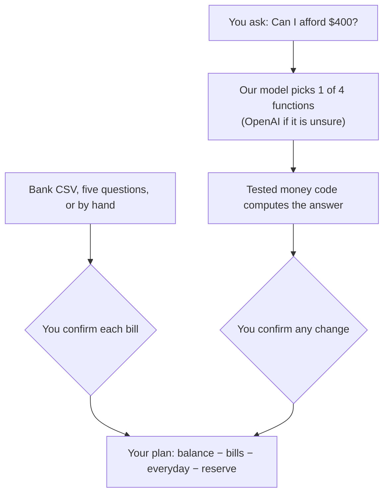

# Covered

**Know what you can spend until your next paycheck.**

[](https://github.com/chinusoid/FractureTeam/actions/workflows/ci.yml)
[](https://covered-fracture.vercel.app)

You have $2,200 in your account and payday is ten days away. Rent, insurance and internet have not gone out yet. Can you buy the $400 sneakers?

Covered's answer: yes, but it puts you $100 below your $250 reserve. Rent, insurance and internet stay covered.

Covered shows working adults in the US how much they can spend until their next paycheck ($300 here), with the money for bills and a chosen reserve set aside, without connecting a bank account. You set it up once, from a bank CSV, five questions or your own numbers. Then you come back on payday: enter your balance, tick what was paid, and see the new number.


- **Live product, no sign-up:** <https://covered-fracture.vercel.app>
- **Pitch deck, 10 slides:** [pitch/covered-pitch.pdf](pitch/covered-pitch.pdf)
- **Every claim, with proof:** [docs/evidence.md](docs/evidence.md)
- **Team and track:** FractureTeam, Business Cup 2.0, track Money

## Try it in a minute: one story

You have $2,200 in your account and payday is ten days away. Open the [live product](https://covered-fracture.vercel.app) and follow the money.

| Step | What you do | What Covered shows | The decision you can now make |
| --- | --- | --- | --- |
| **1. Balance → what is yours** | **Try sample data**, **Continue to setup**, **Confirm 7 bills**, **Confirm** the transfer to savings it flagged, **Build my plan** | $2,200 in the account, **$300** available: $1,300 of bills, $350 of everyday spending and a $250 reserve are set aside | How much you can spend until payday without touching rent, groceries or your reserve |
| **2. A purchase** | On the overview, check a **$400** purchase | "$100 below your $250 reserve; bills and everyday spending are still covered" | Buy it and dip into the reserve, spend $300 instead, or wait for payday. You know what it costs you before you pay |
| **3. A late paycheck** | **What if payday is late?** → **3 days** | Covered, using **$35.46** of your reserve: the savings transfer and the gym now land before the money, plus three more days of everyday spending | Which payment to move or skip if the paycheck slips, decided before it happens |
| **4. A bill is paid** | Rent goes out. **Update balance** → **1100** → tick **Oakwood Apartments** → **Confirm update** | Still **$300**: the rent was already set aside, and nothing is counted twice | Keep spending as planned. Your number stays right after money moves, without a new import |

**See the return without waiting ten days.** On the sample plan, press **Demo: skip to payday** under the number. Covered now says payday has passed and asks for an update first: **Update now**, enter the new balance, tick what was paid, **Start next period**. That is the paid job, so the paywall opens: **Continue to checkout**, **Pay $10.00 (test)**. Nothing is charged. Bills, reserve, settings and saved what-ifs carry over, and the overview shows a recap of the period that ended.

More to try:

- **Ask assistant**: "Can I afford $400 this weekend?" gives the same answer in words. "My car insurance went up by $30" arrives as a draft with a before and after; **Confirm change** moves the plan to **$270**.
- **Save as a what-if** under a purchase check or the late-paycheck card: saved what-ifs sit side by side in **Your what-ifs** and are recalculated whenever the plan changes.
- **Lower it** next to a bill, and **Private, on this device** in the assistant.

## How Covered answers the case

The case: a web product that closes a fundamental money pain for US adults aged 25–45, one they will pay for.

| Judging question | Short answer | Proof |
| --- | --- | --- |
| **Does it work?** (40%) | Yes: live, no sign-up, end to end; tested code computes every dollar | [Production checks](docs/evidence.md#the-product-works-in-production) |
| **What do we sell?** (20%) | The first plan is free. Covered Plus keeps the number right after every paycheck; $10 a month is the price we are testing | [What Plus adds](docs/evidence.md#what-we-sell) |
| **Who do we sell to?** (15%) | Working adults, 25–45, paid every two weeks, with bills between paychecks, who do not want to connect their bank to one more app | [Market numbers](docs/evidence.md#market-numbers-in-the-deck) |
| **Why does it make money?** (15%) | We keep $9.38 of $10. In the base scenario a subscriber stays 4 months (LTV $38); $100M ARR is 834,000 subscribers, 0.9% of US adults aged 25–44. Scenarios with assumptions, not forecasts | [Unit economics](docs/evidence.md#market-numbers-in-the-deck) |
| **Is it new?** (10%) | It names what a purchase breaks, asks for no bank login, and runs our own model on your device | [Only in Covered](docs/features.md#only-in-covered) |

### Does it work? (40%)

- **Live end to end, no sign-up:** CSV import, recurring-bill detection, a plan, purchase checks, bill changes in plain English, balance updates, private mode. Try it at <https://covered-fracture.vercel.app>.
- **The core is real code, not a mockup:** money is integer cents in `app/src/lib/finance`; the sample goes through the same CSV import as a real file (`app/src/lib/import`).
- **AI cannot make up money:** the model only picks one of four functions (`app/src/lib/ai/tools.ts`); any dollar figure in its text that does not match a computed value is replaced (`app/src/lib/ai/guard.ts`).
- **Tested:** 204 unit tests, 25 assistant scenarios, browser walkthroughs at desktop and phone size in CI on every pull request, and a release check against production with the real model.

### What do we sell? (20%)

We sell keeping the number right after every paycheck, not a number of AI questions.

| Free: get your number | Covered Plus: keep it right |
| --- | --- |
| Build the first plan | Carry the plan from paycheck to paycheck |
| See what you can spend until payday | See what changed since last time, and why |
| Check a purchase before you make it | Save and compare what-ifs: a purchase, a new bill, a late paycheck |
| Update your balance until payday | A payday reminder and a recap of the period |
| Get the math explained by the assistant on your device | |

- **$10 a month is a price we are testing, not a proven one.** Carrying the plan to the next paycheck, or saving the first what-if, opens the paywall: the price, then a checkout. The checkout runs in test mode: nothing is charged and no card is asked for, and each completed checkout is counted (`app/src/components/Plus.tsx`, `app/src/app/api/plus/route.ts`). That is interest. Willingness to pay is proven only by a real purchase in a paid pilot, and if the free purchase check turns out to be enough for people, the subscription model has to change.
- **Coming back takes a few fields, not a new import.** Open the reminder, enter your balance, tick what was paid, see the new number. Bills, the reserve and settings carry over to the next pay period (`startNextPeriod` in `app/src/lib/client/model.ts`), and the overview then shows a recap of the period that ended. You import once; coming back never needs a file. What we measured is below.
- **An old balance is not shown as today's answer.** The overview always says how old the balance is. After a week, or once payday has passed, the overview holds back every figure computed from it and asks for the update first (`app/src/components/Dashboard.tsx`).
- **What-ifs stay true.** A saved what-if is re-evaluated against the plan every time it changes (`app/src/lib/client/scenarios.ts`).
- The cloud assistant answers 5 questions a day on the free plan and 60 on Plus; the assistant on your device has no limit. Payment is not connected yet.

**Measured, 15 Nov.** `npm run measure` against production: the synthetic sample CSV, desktop Chromium at 1280×800, 7 runs of each scenario. A script did the steps, so this is how much a person has to do and the product's own share of the time. It is not how long a person takes.

| Scenario | What a person has to do | Product's own time, median |
| --- | --- | --- |
| First plan from a bank CSV | 5 clicks, 1 file, 1 field (the balance) | 0.3 s |
| Update after paying a bill | 2 clicks, 1 tick, 1 field | 0.1 s |
| Payday update that starts the next period | 2 clicks, 3 ticks, 1 field | 0.2 s |

How long people take is not measured yet, so we do not quote a number of seconds. `npm run measure -- --person` keeps time while a person does the same steps; timing it with users is the first test on the deck's last slide.

**The $10 question, in three answers.**

1. **What a subscriber gets.** The plan carried from paycheck to paycheck (bills, reserve, settings and what-ifs), what changed since last time and why, saved what-ifs recalculated on every change, a payday reminder and a recap of the period that ended.
2. **Why it is needed every pay period.** The number is right for one balance and one set of bills. Every paycheck changes the balance, which bills fall before the next payday and what has already been paid, so the plan has to be redone each time: 26 times a year for someone paid every two weeks. Free gets you the number once; Plus keeps it right.
3. **How we test the price.** The paywall is live where the paid job happens, with a checkout in test mode, and each completed checkout is counted: that is interest, not proof. Proof is a paid pilot with a real $10 charge, where we watch who pays and who comes back after their next paycheck. If the free purchase check turns out to be enough for people, the model changes.

### Who do we sell to? (15%)

- **Starting segment:** working adults in the US, 25–45, paid every two weeks, with bills due between paychecks, who do not want to connect their bank to one more app.
- **Every two weeks is the most common pay schedule:** 43% of US private establishments pay that way (BLS, February 2023).
- **Bank logins are a real barrier:** 24% of consumers are slightly or not at all comfortable sharing bank credentials with third-party apps (PYMNTS and MX, 2021).
- **The pain is measured:** 63% of Americans live paycheck to paycheck; 37% would not cover a surprise $400 expense with cash or its equivalent; card issuers charged $14.5B in late fees in one year.
- **A bank connection is deliberately later.** It would cut manual work, but it changes the privacy promise, so it waits until the payday update has been timed with people.

### Why does it make money? (15%)

These are scenarios with assumptions, not forecasts: nobody has paid yet.

| | Number | What it rests on |
| --- | --- | --- |
| Margin | We keep about **$9.38** of every $10 | Fact: Stripe's list fee ($0.59) and the measured AI cost (about 3¢ for 100 questions; at most 54¢ at the 60-a-day cap; $0 when our model answers) |
| Scale | $100M ARR is **834,000** subscribers | Arithmetic at $10 a month: about 0.9% of ~89 million US adults aged 25–44. Whether that many will pay is not known |
| Retention | About **4** paid months in the base scenario | Assumption: 55% renew after month one (RevenueCat's 54–57% for comparable monthly plans), then 82% a month |
| LTV and CAC | LTV **$38**, so winning a subscriber must cost under **$13** | Follows from the two rows above. At 6 months it is $56 and $19; at 12 months, $113 and $38. At $9.38 a month, $13 pays back in under 2 months |
| CAC by channel | Search and communities → the free purchase check: content cost only. Creators: paid per subscriber, capped at **$13**. Paid ads: not before the pilot | Assumption: 2% of free plans become paid, so $13 buys 50 free plans, $0.26 each. Paid clicks cost more than that, so ads wait until retention is measured |

The paid pilot measures CAC and months retained and replaces these assumptions.

### Is it new? (10%)

- **It names what a purchase breaks** (your reserve, everyday spending or a bill), where PocketGuard shows a leftover and YNAB assigns money to targets.
- **No bank login, by design.** The plan is built in your browser from a file, five questions or your own numbers, and stays there.
- **Our own model, covered-nlu-1, runs in the browser** in private mode and sends nothing (`app/src/lib/client/onDevice.ts`).
- **What if payday is late?** shows which bills land before a delayed paycheck (`app/src/lib/client/stress.ts`).
- **Lower a bill yourself:** what to say, with your own numbers (`app/src/lib/client/lowerBill.ts`), where Rocket Money keeps 35–60% of the first year's savings.

What is **not** proven yet: how common the pain is in our segment, willingness to pay $10, and retention. We have not interviewed users. The deck's last slide gives the two tests that answer this and what counts as a pass.

## How it works



- **Money** is integer cents in `app/src/lib/finance`, shared by the browser and the server.
- **The plan lives in your browser** (local storage). The server stores no financial data; it keeps usage counters for quotas.
- **The assistant** is off until you agree. It can only call four functions: plan summary, purchase check, propose a bill change, propose a new bill. A change applies only after **Confirm**, and only if the plan has not changed since.
- **Our own model, covered-nlu-1**, answers in production: about 254K parameters, trained by us on 7,672 synthetic examples, about 1–2 ms and $0 per request. When it is under 50% sure, OpenAI answers instead, and the app says which model replied. In private mode it runs in the browser and nothing is sent.

**Built with.** Next.js 16 and React 19 in one app on Vercel, TypeScript, and zod to validate every request and the saved plan. Two outside services: OpenAI (`gpt-6-luna`) as the backup when our model is unsure, and Upstash Redis for usage counters. There is no database, no analytics and no payment provider; the plan stays in the browser's local storage. Tests run on vitest and Playwright.

Details: [the assistant and our model](docs/assistant-and-ai.md) · [the money math and CSV import](docs/money-and-csv.md) · [every feature](docs/features.md)

## Code map

```text
app/                      Next.js 16 + TypeScript, deployed on Vercel
  src/app/api/            assistant, intake (five questions), plus (offer counter), health
  src/components/         screens: Landing, ImportScreen, SetupScreen, InterviewScreen, Dashboard, Assistant, management
  src/lib/finance/        the plan and proposals, integer cents          ← the core
  src/lib/import/         CSV reading, normalising, recurring-bill detection
  src/lib/ai/             server assistant: tools, guard, prompts, providers, quotas
  src/lib/ai/own/         our model's runtime and weights
  src/lib/client/         browser side: on-device model, stress test, lower-a-bill, reminders
  tests/unit/             204 unit tests (vitest)
  tests/ai-eval/          25 assistant scenarios and 34 interview scenarios
  tests/e2e/              browser walkthroughs (Playwright), the production release check, the timing script
  tools/ml/               training data generator and training script for covered-nlu-1
pitch/                    the deck (PDF, PPTX) and the script that builds it from product screenshots
docs/                     evidence, architecture details, feature list
```

## Quality

| Check | Result | Command (from `app/`) |
| --- | --- | --- |
| Unit tests | 204 passed | `npm test` |
| Typecheck | clean, `strict` | `npm run typecheck` |
| Our model alone, 25 assistant scenarios | 24 of 25 (CI requires 90%) | `AI_PROVIDER=own AI_FALLBACK_TO_OPENAI=false npx tsx tests/ai-eval/run.ts` |
| Browser walkthrough, 1280 and 390 px | passed | `npm run e2e` (with the app running) |
| Work and product time for the first plan and the payday update | measured on production, 15 Nov | `BASE_URL=https://covered-fracture.vercel.app npm run measure` |
| Production release check, real model | passed on 15 Nov after the last deploy | `BASE_URL=https://covered-fracture.vercel.app node tests/e2e/release.mjs` |

CI runs typecheck, unit tests, the assistant scenarios on the test model and on our own model, the build, and two browser walkthroughs on every pull request.

## Run it

Requires Node.js 20.9+.

```sh
cd app
npm ci
npm run dev          # http://localhost:3000
```

The plan, import and purchase check work without any key. For the assistant, copy `app/.env.example` to `app/.env.local`: `AI_PROVIDER=own` runs our model with no key; `OPENAI_API_KEY` adds the backup. Configuration and deployment: [docs/assistant-and-ai.md](docs/assistant-and-ai.md#configure).

## How it was built

Built during the event, 14–15 Nov 2026, by FractureTeam. AI coding assistants (Claude Code and Codex) were used throughout, which the organisers confirmed is allowed; commits authored "Claude" come from Claude Code. The first working version was put together in a separate working repository, [Fraction_team](https://github.com/abilkhayrbigali-design/Fraction_team), and imported in the first commit at 19:15 Astana time on 14 Nov. From then on every change went through a pull request checked by CI (more than 20 merged by the morning of 15 Nov), and production is deployed from `main`.

Design: a quiet workspace in white and pale cream `#f6f7ed`, set in Instrument Sans. Small text was raised to 11–13px and muted text meets WCAG AA contrast.
