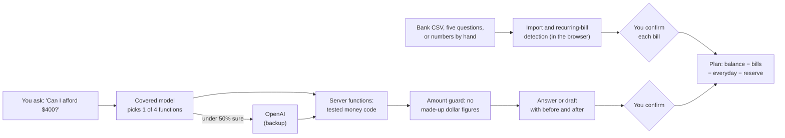

# Covered

**Know what's covered before you spend.**

[](https://github.com/chinusoid/FractureTeam/actions/workflows/ci.yml)
[](https://covered-fracture.vercel.app)

You have $2,200 in your account and payday is ten days away. Rent, insurance and internet have not gone out yet. Can you spend $400?

Covered is a bill planner for working adults in the US. It reads your bank's CSV, finds the bills that repeat, and turns your balance into one honest number: what is left after bills, everyday spending and a reserve. Then you can ask it about any purchase, and it tells you what that purchase would touch.


| | |
| --- | --- |
| **Live product** (no sign-up) | <https://covered-fracture.vercel.app> |
| **Pitch deck** (10 slides) | [pitch/covered-pitch.pdf](pitch/covered-pitch.pdf) |
| **Every claim, with proof** | [docs/evidence.md](docs/evidence.md) |
| **Team, track** | FractureTeam, Business Cup 2.0, track Money |

## Try it in a minute

1. Open the live product and press **Try sample data**. A synthetic three-month bank export goes through the real import.
2. **Continue to setup**, press **Confirm 7 bills**, decide on the flagged savings transfer, then **Build my plan**: $2,200 in the account, **$300** is yours.
3. **Ask assistant**: "Can I afford $400 this weekend?" The answer: $100 below your reserve; bills and everyday spending are still covered.
4. "My car insurance went up by $30" arrives as a draft with a before and after. **Confirm change** and the plan moves to **$270**.
5. Try **What if payday is late?** on the overview, **Lower it** next to a bill, and **Private, on this device** in the assistant.

## How Covered answers the case

The case: a web product that closes a fundamental money pain for US adults aged 25–45, one they will pay for.

| Criterion | What we built | Where to verify |
| --- | --- | --- |
| **Does it work?** (40%) | Live end to end with no sign-up: CSV import, recurring-bill detection, a plan, purchase checks, bill changes by sentence, balance updates, private mode. Tested code computes every dollar; the model only picks one of four functions. | [Live site](https://covered-fracture.vercel.app); `app/src/lib/finance`; 171 unit tests; browser walkthroughs in CI and against production ([evidence](docs/evidence.md#the-product-works-in-production)) |
| **What do we sell?** (20%) | Covered Plus, $10 a month: the cloud assistant, up to 60 questions a day, where our model has OpenAI behind it for anything it is unsure about; next, with the pilot, bank sync so the plan keeps itself current. Free: the plan, the purchase check, payday reminders, 5 cloud questions a day, and private mode on our model alone. The sixth cloud question shows the offer in the product, and we count who takes it; payment is not connected yet. People come back every payday, when a bill changes, and before a purchase. | `app/src/components/Assistant.tsx` (offer), `app/src/app/api/plus/route.ts` (counter), `app/src/lib/client/reminder.ts` (payday reminder) |
| **Who do we sell to?** (15%) | A working adult in the US paid on a schedule, with several fixed bills, who tried a budgeting app and stopped keeping it up. 63% of Americans live paycheck to paycheck; 37% could not cover $400 from cash. | Deck slides 2–3; sources in [evidence](docs/evidence.md#market-numbers-in-the-deck) |
| **Why does it make money?** (15%) | We keep about $9.38 of every $10: the card fee, and about 3¢ of AI at 100 questions a month (at most 54¢ if a subscriber used all 60 a day and each went to OpenAI). $100M ARR is 834,000 subscribers, about 0.9% of US adults aged 25–44. Base case: 55% renew after month one and 82% a month after that, about 4 paid months, so LTV $38 and CAC must stay under $13. That rules out paid ads at first: the free, no-sign-up purchase check is the first channel. | Deck slide 9 |
| **Is it new?** (10%) | The answer names what a purchase would break (the reserve, everyday spending or a bill), not only a leftover. Our own model runs in the browser in private mode and sends nothing. A late-payday stress test. Scripts to lower a bill yourself, where Rocket Money keeps 35–60% of the savings. | `app/src/lib/client/onDevice.ts`, `stress.ts`, `lowerBill.ts` |

What is **not** proven yet: how common the pain is in our segment, willingness to pay $10, and retention. We have not interviewed users. The deck's last slide gives the two tests that answer this and what counts as a pass.

## How it works



- **Money** is integer cents in `app/src/lib/finance`, shared by the browser and the server.
- **The plan lives in your browser** (local storage). The server stores no financial data; it keeps usage counters for quotas.
- **The assistant** is off until you agree. It can only call four functions: plan summary, purchase check, propose a bill change, propose a new bill. A change applies only after **Confirm**, and only to the plan version it was drafted for.
- **Our own model, covered-nlu-1**, answers in production: about 254K parameters, trained by us on 7,672 synthetic examples, about 1–2 ms and $0 per request. When it is under 50% sure, OpenAI answers instead, and the app says which model replied. In private mode it runs in the browser and nothing is sent.

Details: [the assistant and our model](docs/assistant-and-ai.md) · [the money math and CSV import](docs/money-and-csv.md) · [every feature](docs/features.md)

## Code map

```text
app/                      Next.js 16 + TypeScript, deployed on Vercel
  src/app/api/            assistant, intake (five questions), plus (offer counter), health
  src/components/         screens: Landing, ImportScreen, SetupScreen, InterviewScreen, Dashboard, Assistant, management
  src/lib/finance/        the plan and proposals, integer cents          ← the core
  src/lib/import/         CSV reading, normalising, recurring-bill detection
  src/lib/ai/             server assistant: tools, guard, prompts, providers, quotas
  src/lib/ai/own/         our model's runtime and weights
  src/lib/client/         browser side: on-device model, stress test, lower-a-bill, reminders
  tests/unit/             171 unit tests (vitest)
  tests/ai-eval/          25 assistant scenarios and 34 interview scenarios
  tests/e2e/              browser walkthroughs (Playwright) and the production release check
  tools/ml/               training data generator and training script for covered-nlu-1
pitch/                    the deck (PDF, PPTX) and the script that builds it from product screenshots
docs/                     evidence, architecture details, feature list
```

## Quality

| Check | Result | Command (from `app/`) |
| --- | --- | --- |
| Unit tests | 171 passed | `npm test` |
| Typecheck | clean, `strict` | `npm run typecheck` |
| Our model alone, 25 assistant scenarios | 24 of 25 (CI requires 90%) | `AI_PROVIDER=own AI_FALLBACK_TO_OPENAI=false npx tsx tests/ai-eval/run.ts` |
| Browser walkthrough, 1280 and 390 px | passed | `npm run e2e` (with the app running) |
| Production release check, real model | passed on 15 Nov after the last deploy | `BASE_URL=https://covered-fracture.vercel.app node tests/e2e/release.mjs` |

CI runs typecheck, unit tests, the assistant scenarios on the test model and on our own model, the build, and two browser walkthroughs on every pull request.

## Run it

Requires Node.js 20.9+.

```sh
cd app
npm ci
npm run dev          # http://localhost:3000
```

The plan, import and purchase check work without any key. For the assistant, copy `app/.env.example` to `app/.env.local`: `AI_PROVIDER=own` runs our model with no key; `OPENAI_API_KEY` adds the backup. Configuration and deployment: [docs/assistant-and-ai.md](docs/assistant-and-ai.md#configure).

## How it was built

Built during the event, 14–15 Nov 2026, by FractureTeam. AI coding assistants (Claude Code and Codex) were used throughout, which the organisers confirmed is allowed; commits authored "Claude" come from Claude Code. The first working version was put together in a separate working repository, [Fraction_team](https://github.com/abilkhayrbigali-design/Fraction_team), and imported in the first commit at 19:15 Astana time on 14 Nov. From then on every change went through a pull request checked by CI (21 merged by the morning of 15 Nov), and production is deployed from `main`.

Design: a quiet workspace in white and pale cream `#f6f7ed`, set in Instrument Sans. Small text was raised to 11–13px and muted text meets WCAG AA contrast.
